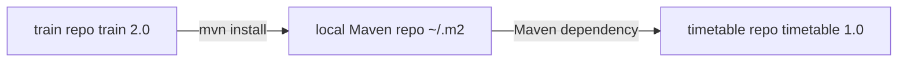

# North Pole Southern Timetable

A toy Java 8 Maven console application (`com.northpolesouthern:timetable:1.0`) that displays a formatted timetable of train departures and arrivals.

## What it does

**`TimetableApp`** reads train objects from the [train](../northpolesouthern-train) library and prints each train's departure station and time, destination station and time.

## Inter-application dependency role

This project is the **consumer** application. It lives in its own git repo and builds independently, but depends on the train artifact via Maven:

```xml
<dependency>
  <groupId>com.northpolesouthern</groupId>
  <artifactId>train</artifactId>
  <version>2.0</version>
</dependency>
```

There is no shared parent POM or multi-module build — the link between the two applications is purely through Maven coordinates.



## Prerequisite

The train project must be installed locally before building timetable:

```bash
cd ../northpolesouthern-train
mvn clean install
```

## Build and run

```bash
mvn clean package
cd target
java -jar timetable-1.0.jar
```

The jar expects a `lib/` directory alongside it (populated automatically by `mvn package`). Alternatively, run from the project root with:

```bash
mvn exec:java
```
