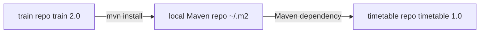

# North Pole Southern Train

A toy Java 8 Maven library (`com.northpolesouthern:train:2.0`) that defines train routes for the North Pole Southern railway.

## What it contains

- **`Train`** — immutable model with name, departure station/time, and destination station/time
- **`TrainCatalog`** — hard-coded sample list of North Pole–themed trains
- **`TrainApp`** — optional entry point that prints the catalog to the console

## Inter-application dependency role

This project is the **provider** artifact in a two-app setup. It lives in its own git repo and builds independently. The sibling [timetable](../northpolesouthern-timetable) application declares a Maven dependency on this GAV:

```
com.northpolesouthern:train:2.0
```

There is no shared parent POM or multi-module build — the link between the two applications is purely through Maven coordinates.



## Build and publish locally

Install the jar into your local Maven repository so timetable can resolve it:

```bash
mvn clean install
```

This publishes to `~/.m2/repository/com/northpolesouthern/train/2.0/`.

## Run standalone (optional)

```bash
mvn package
java -jar target/train-2.0.jar
```
